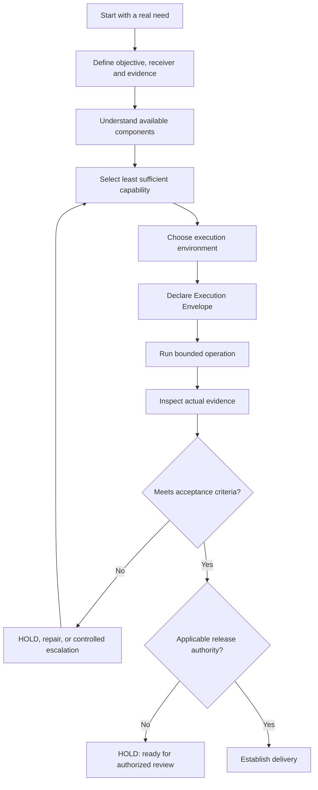
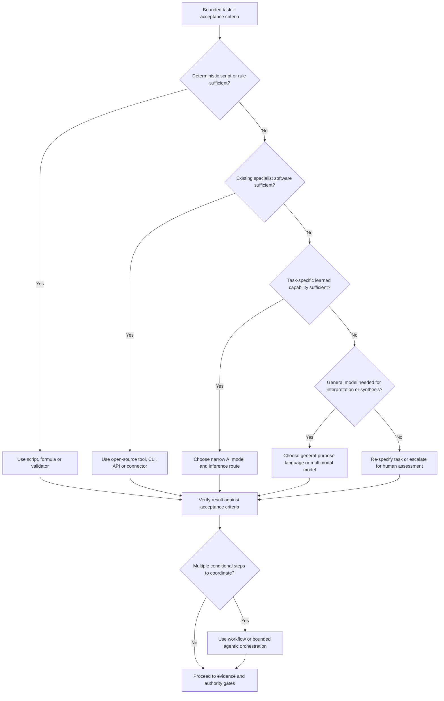
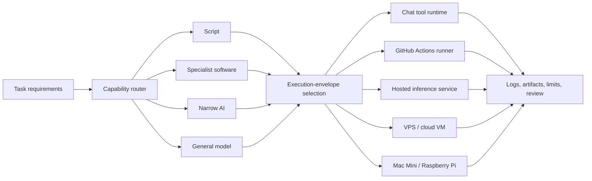
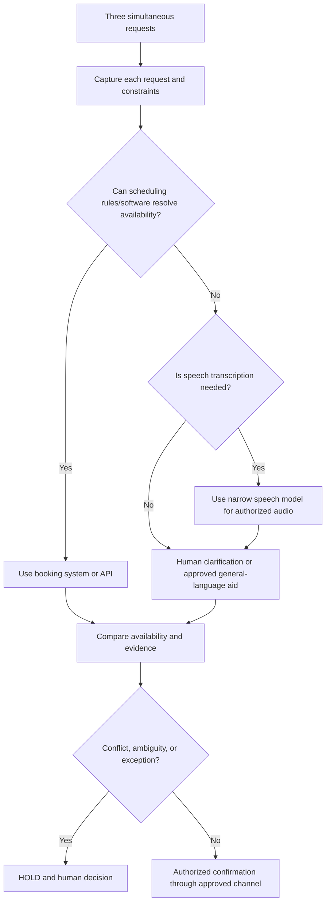
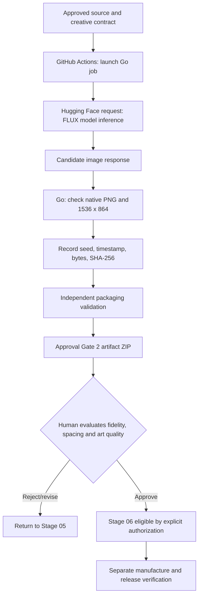
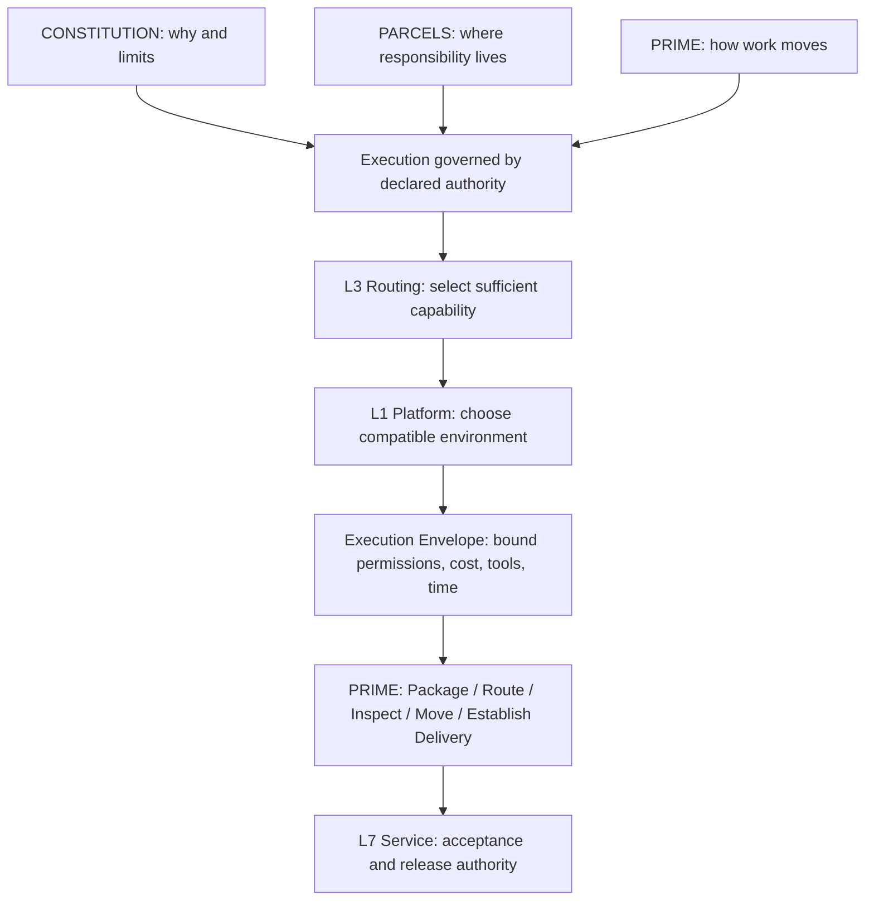
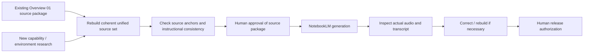

# BOSS / Bioscillate — Day Zero Unified Learning Architecture

**Working title:** *From AI Consumer to Governed Operator*  
**Subtitle:** *Understanding AI Systems, Choosing the Right Intelligence, and Governing Execution*  
**Editorial target:** 75–90 minutes of meaningful teaching; duration **not guaranteed** by NotebookLM.  
**Audience:** Nontechnical beginners, small-business operators, and emerging AI workflow designers.  
**Production status:** Candidate source architecture. This file is **not** an audio transcript, proof of completed NotebookLM generation, validation of learner outcomes, or authorization to modify ratified doctrine.

## 0. Executive decision

**Recommendation: MERGE the instructional foundations of the original Day Zero Overview 01 and the proposed execution-environment / capability-escalation material into one coherent opening experience.** Rebuild, do not simply append two scripts. Preserve the dedicated MCP-client and API lessons as subsequent episodes; do not quietly displace their existing proposed curriculum coordinates.

> **Core teaching claim:** A governed operator begins with the problem, selects the least complex **sufficient and verifiable** capability, chooses where it executes, constrains its authority, and establishes evidence of the intended outcome.

The David Andre transcript contributes a useful explanation of agentic loops, triggers, isolation, orchestration, and the shift from individual prompting toward repeatable execution. Its claims that AGI has arrived, that cloud is categorically superior, or that humans should be removed from every loop are **external assertions and interpretations, not BOSS facts or accepted doctrine**.

**BOSS counterprinciple:** Remove unnecessary human handling from authorized execution; retain accountable authority over consequential decisions, exceptions, and release.

## 1. The unified learning journey

**Learning target:** The learner can explain why obtaining an answer, completing an execution, validating an artifact, and authorizing release are different states.

### Existing material that must survive the rebuild

| Original Overview 01 domain | Its teaching responsibility | Status in unified design |
|---|---|---|
| Outputs versus outcomes | Reply ≠ task complete | **Preserve** opening foundation |
| Systems thinking | Inputs, rules, exceptions, repair | **Preserve** |
| BOSS identity | Portable governed operating method, not literal OS kernel or SaaS feature parity | **Preserve** |
| AI vocabulary | Models, agents, tools, skills, workflows, plugins, APIs, MCP | **Preserve and sequence** |
| Logistics ontology | Cargo, sender/receiver, manifests, PRIME, proof of delivery | **Preserve** canonical metaphor |
| Manual First, Automated Second, Governed Always | Trace real handoffs and error modes before automation | **Preserve** |
| Source-admission case | The mislabeled ebook, hash ≠ truth/authorship | **Preserve** with evidence qualifications |
| Learning Envelope | MISSION ≠ CURRICULUM ≠ LESSON; observed proficiency matters | **Preserve** and assess |

**Curriculum-coordinate warning:** An earlier candidate episode series gave Episode 02 to **MCP: The Client Side** and Episode 03 to **APIs**. This merged opening unit should not silently erase them. Exact numbering, run time, and source set must be reconciled during curriculum review.

## 2. Capability selection: the missing routing decision

Do not begin with *Which AI model should we use?* Begin with *What outcome is required, and what is the least complex capability that can reliably achieve it?*

**Interpretation note:** This is a **routing checklist**, not five mandatory processing hops or a claim that agentic orchestration is a fifth type of intelligence. An orchestrator may coordinate scripts only, narrow models only, or a mixture. A task with known image-recognition requirements may be routed directly to a specialist model after constraints are established.

| Capability | First test | Illustrative tool/task | Reason to escalate |
|---|---|---|---|
| Deterministic script | Can explicit rules reliably yield checkable results? | Go/Python hashes, dimensions, JSON validation | Data/task exceeds expressible rules |
| Existing specialist software | Is there a maintained capable program already? | FFmpeg conversion; VTracer vectorization; OCR engine | The task needs learned pattern inference unavailable in tool |
| Narrow AI | Is one bounded learned task enough? | Whisper transcription; text classifier; segmentation; diffusion image generation | Broader language, ambiguity or contextual synthesis required |
| General-purpose model | Does the task require flexible interpretation, generation or synthesis? | Compare a teaching claim to source excerpts; draft instructional copy | Need conditional tools/steps and managed recovery |
| Orchestration | Are multiple bounded operations and state transitions necessary? | GitHub Actions job; workflow runner; agentic dispatcher | This is a coordination layer, not automatically a larger AI model |

### Hugging Face: the specialist intelligence layer

Hugging Face is useful for teaching **task-first model discovery**: transcription, text classification, embeddings, segmentation, and text-to-image are distinct model capabilities. A model may execute locally, on privately controlled infrastructure, or through a compatible hosted inference provider. Performance, safety, license, privacy, pricing, and service availability must be checked in the actual environment.

**Crucial separation:** *Inference provider* is the **execution/hosting route** for a model, not an intelligence class. A provider may host narrow AI or a large model. Narrow models are not invariably cheaper or better; benchmark actual task performance and total resource cost.

## 3. Two orthogonal choices: capability and execution location

| Environment | Typical function | Constraint to explain in Day Zero |
|---|---|---|
| Chat assistant tool runtime | Interactive experiment and tool invocation | Tool/session permissions and persistence vary |
| GitHub Actions runner | Event/manual-triggered finite jobs, outputs, logs | Ephemeral compute; workflow registration, permissions, secrets and artifacts matter |
| Hugging Face Inference Providers | Hosted model execution | Provider/model compatibility, account permissions, cost and response contract |
| VPS/cloud VM | Configurable persistent applications and queues | Patching, hardening, monitoring, uptime and operating cost |
| Mac Mini | Local application and possibly model execution | Power, network, thermal/capacity and security management |
| Raspberry Pi | Lightweight local automation, triggers and services | RAM/CPU limits; most large models require a different inference route |

**Do not conflate:** An isolated sandbox is not proof of complete security. Cloud capacity is not infinite; quotas and costs exist. Self-hosted inference is not free after purchasing hardware. A secret in GitHub Actions reduces exposure when correctly scoped but does not mathematically guarantee security.

## 4. Worked case A: the barbershop

**Situation:** A neighborhood barbershop receives a walk-in, a phone call, and an online appointment request. This is an **illustrative instructional scenario**, not verified customer data or an implemented Market 7 workflow.

The teaching win: the operator does **not** buy an agent before tracing the process. A scheduling system can solve availability; transcription is a different task; an ambiguous exception may need human judgment. The boundary between a suggested booking and an authorized confirmation is explicit.

## 5. Worked case B: DraftDeck Stage 05 — the actual vertical slice

**Declared objective:** Generate and inspect candidate text-free artwork for Slide 05 of *Enterprise AI Operations Manual*, preserving the two-condition Split-Signal Error teaching claim: **divergence AND absent verification**. The art depicts a print-proof registration bench rather than an anthropomorphic machine.

| Work | Capability route | Appropriate proof |
|---|---|---|
| Parse or rasterize source PDF | Conventional PDF tooling | Source page, metadata, checksum where obtained |
| Establish teaching invariants | Source-grounded analysis and human review; general model only where useful | Accepted Creative Contract |
| Generate a novel illustrative scene | Text-to-image specialist model via provider | Actual PNG + model/request provenance |
| Validate 16:9 size | Deterministic Go/Python | Width/height result, script logs |
| Record hashes and package ZIP | Deterministic code | Manifest, archive checksum, integrity checks |
| Approve art meaning | Human visual review | Explicit Gate 2 disposition |
| Manufacture editable text | React/Tailwind and applicable tools | DOM inspection and rendered comparison |
| Approve release | Authorized reviewer | Verified artifact + recorded authorization |

**Current demonstrated boundary (as of this candidate):** [DraftDeck PR #49](https://github.com/smithjon1980/DraftDeck/pull/49) contains manually triggered candidate-generation tooling submitted for review. The live Hugging Face transport and generated image candidates have **not been independently verified in this record**. A committed workflow is not proof that inference was executed or that artwork was approved.

> **Teaching sentence:** GitHub Actions executes a program that **requests** model inference; the inference provider runs the model; the operator judges whether the result satisfies the lesson. These are different roles.

## 6. BOSS doctrinal placement

No new constitutional layer is proposed. Capability escalation is a **routing specialization** governed by existing authority and evidence doctrines.

| Construct | Responsibility in unified overview | Safeguard |
|---|---|---|
| Constitution | Purpose, limits, restraint | POWER = GOVERNED FLOW |
| PARCELS L1 Platform | Runtime, compute, storage, access | Capability and resource reality |
| PARCELS L2 Attachment | Package identity, integrity, provenance | Hash ≠ truth, authorship, or permission |
| PARCELS L3 Routing | Choose eligible tool/model/handler and destination | Least sufficient, justified capability |
| PARCELS L4 Carriage | Retry, timeout, idempotency, cancellation | A retry must not silently duplicate side effects |
| PARCELS L5 Exchange | Durable task and handoff identity | Work survives session disappearance |
| PARCELS L6 Language | Schema and representation | Parse success ≠ meaning correctness |
| PARCELS L7 Service | Acceptance, fitness, release | TEST PASS ≠ DELIVERY ESTABLISHED |
| Execution Envelope | Bounded unattended autonomy | No privilege expansion via escalation |
| PRIME | Package → Route → Inspect → Move → Establish Delivery | Movement ≠ verification |
| SEVEN | Survey → Evaluate → Validate → Execute → Normalize | Decision discipline, **not** replacement for PRIME |
| Learning Envelope | Mission, learner state, learning evidence | CONTENT DELIVERED ≠ LEARNING ESTABLISHED |

### Candidate operational rule (not ratified)

> For each bounded work package, identify the least complex **sufficient, verifiable, and governable** capability. Escalate only for a documented shortfall. Escalation may change technology, but it must not silently increase authority. Reassess the Execution Envelope, acceptance criteria, cost, and verification whenever the route changes.

**Doctrine-change policy:** This file preserves doctrinally grounded ideas but does not amend constitutional sources. If research justifies a doctrinal change while unpublished, rebuild the affected coherent candidate from current understanding and submit it through review; preserve prior candidates in version history rather than stacking patch notes.

## 7. Rebuilt opening audio architecture

**Podcast shape:** Two hosts—one curious nontechnical operator and one careful systems educator—follow the same business problem and later examine DraftDeck. Explain concepts plainly before using abbreviations. Do not read production metadata aloud. Include respectful disagreement, failure/recovery moments, reflective questions, and a bounded learner exercise.

| Segment | Narrative question | Lesson | Artifact/evidence |
|---|---|---|---|
| 01. From consumer to operator | What is the business outcome? | Answer ≠ verified delivery | Defined outcome |
| 02. Systems and BOSS | What must exist before acting? | Inputs, constraints, exception routes, responsibility | Work-package sketch |
| 03. Vocabulary and connections | What is a model, tool, skill, plugin, API or MCP? | Interfaces and capabilities are not interchangeable | Component relationship diagram |
| 04. Escalate intelligently | Can a script do it? What about specialist software or narrow AI? | Least sufficient capability | Routing decision record |
| 05. Where the work lives | Chat, GitHub Actions, Hugging Face, VPS or local hardware? | Capability versus execution location | Environment choice |
| 06. Governed automation | When may a trigger run unattended? | Execution Envelope, bounded loops, STOP/HOLD | Authorized workflow boundaries |
| 07. Evidence and authority | Does the artifact prove what it claims? | Authentic source, inspect, recover, release | Verification profile |
| 08. Learner mission | Can you explain and judge the process? | Learning must be demonstrated | Exit task |

**Target length:** ~75–90 minutes for combined source depth, subject to actual generation controls. Better to divide audio into coherent parts than to pad, truncate important caveats, or claim a duration that the tool did not produce. The prior package targeted 60 minutes and was not automatically audio-verified. This candidate does not retroactively certify that output.

### Required audio distinctions

- **Model ≠ agent ≠ tool ≠ workflow.** A model provides capability; an agent applies capabilities in an operational loop; tools expose operations; workflows define sequencing and conditions.
- **Plugin ≠ MCP server ≠ skill.** A plugin connects app capabilities when authorized; MCP standardizes exposed tools/resources/prompts; a skill conveys reusable workflow instructions.
- **MCP client is software in the host application.** The human operator is not literally an MCP client.
- **Inference provider ≠ narrow AI ≠ LLM.** Hosting and intelligence type are separate decisions.
- **Generated polish ≠ source alignment.** A plausible output may still violate its ground truth.
- **Hash ≠ authenticity or correctness.** A checksum identifies bytes; it does not prove publisher, factual accuracy, licensing, or human authority.
- **Autonomy ≠ authority.** Automation may act within preauthorized bounds; unapproved release stays HOLD.
- **PARCELS ≠ PRIME ≠ SEVEN.** Structural location, package movement, and decision discipline have separate roles.

## 8. NotebookLM source architecture and governance

Rebuild Overview 01 and the new additions as a clean, bounded source set. Do not submit the raw YouTube transcript as unqualified authority.

| Proposed source file | Content | Evidence class |
|---|---|---|
| `01_PURPOSE_AND_SYSTEMS.md` | Business problem, systems thinking, outcomes, BOSS identity | Existing source + instructional synthesis |
| `02_CONSTITUTION_LOGISTICS_PRIME.md` | Logistics ontology, PARCELS, PRIME, SEVEN, bounded authority | Canonical doctrines with traceable source anchors |
| `03_AI_COMPONENTS_AND_INTERFACES.md` | Models, agents, skills, APIs, tools, plugins and MCP | Technical explanation + cited standard where appropriate |
| `04_CAPABILITY_ESCALATION.md` | Script → specialist software → narrow AI → general model; orchestration as separate axis | **Candidate specialization** |
| `05_EXECUTION_ENVIRONMENTS.md` | Tool runtime, Actions, inference, VPS and local hardware | Technical explanation requiring freshness review |
| `06_EVIDENCE_AND_VERIFICATION.md` | Contaminated ebook case, unknown states, review and release | Grounded case + doctrines; do not fabricate missing details |
| `07_BARBERSHOP_AND_DRAFTDECK_CASES.md` | Hypothetical shop and observed/aspirational DraftDeck workflow | Explicit illustrative versus verified markings |
| `08_LEARNING_ENVELOPE_AND_ASSESSMENT.md` | Learning outcomes, reflection, short practice, review rubric | Learning doctrine + candidate teaching design |

**Companion production records:** `SOURCE_MANIFEST.md`, `CUSTOM_PROMPT.md`, `QA_CHECKLIST.md`, `PRODUCTION_LOG.md`, and `CORRECTION_LOG.md`. These should be prepared and versioned as a candidate package; do not mark execution complete until audio, actual transcript and source alignment have been inspected.

## 9. A bounded learner exit exercise

A learner names one recurring task (for example: process voicemail, publish a workshop announcement, or produce a simple chart), then completes this table manually:

| Check | Learner response required |
|---|---|
| Objective | What exact result is needed? |
| Least sufficient capability | Script, existing tool, task-specific model, general model or orchestration? Why? |
| Environment | Where does execution happen, and why? |
| Permissions and limits | What may the system access or change? |
| Failure / UNKNOWN | What must cause HOLD, retry or escalation? |
| Evidence | What observable facts establish the result? |
| Authority | Who may authorize the next consequential action? |

**Passing evidence:** The learner correctly distinguishes capability from location, narrows scope, chooses a defensible method, identifies at least one real verification check, and does not claim that execution itself confers release authority. Completing the worksheet is **not itself** evidence of competence until it is reviewed against a defined rubric.

## 10. Risk register and explicit boundaries

| Risk | Mitigation |
|---|---|
| Two concepts merged into an incoherent, overly long lecture | Single story arc; two cases, controlled pacing; separate deeper episodes |
| General LLM becomes default for everything | Require least-sufficient capability decision |
| 'Five levels' read as a mandatory linear pipeline | State clearly that selection is a branching router |
| Cloud/sandbox assumed infinitely scalable or secure | Teach quotas, costs, scopes, secrets, failure modes |
| David Andre opinions adopted as BOSS doctrine | Tag as external viewpoint; validate technical claims independently |
| Candidate doctrine passed off as ratified | Status + provenance + human approval gates |
| Generated audio mistaken for verified instruction | Preserve recording, transcript, QA and release evidence |
| Current DraftDeck PR mistaken for successful live artwork | Mark live inference unverified until actual outputs inspected |
| Curriculum Episode 02 displaced unintentionally | Reconcile schedule, preserve MCP client/API depth lessons |
| Teaching diagrams taken as operational controls | Structural-Correspondence Firewall: representation ≠ enforcement |

## 11. Decision and next steps

**Decision proposed:** Accept a **rebuild of the combined opening Audio Overview** as a **candidate**, not an immediate canonical doctrine amendment.

The next production artifact should be the eight proposed grounded source documents with their manifest and NotebookLM customization prompt. The existing Overview 01 materials stay preserved as historical candidate evidence. No GitHub push, NotebookLM ingestion, audio generation, or final curriculum amendment is authorized merely by the existence of this Markdown.

## 12. Source and status register

**Primary user-directed inputs (source-derived)**
- Original Day Zero Overview 01 custom prompt and README, including ~60-minute target, barbershop hook, source-integrity case and learning envelope; retrieved from the user's file Library on 2026-10-15.
- `BOSS_Day_Zero_Episode_Series_v0.1.md`: earlier planned Episode 02 MCP-client lesson and Episode 03 API lesson, plus separate learner-created Episode 08; recovered from the user's file Library.
- User-supplied transcript attributed to David Andre: external explanatory/advocacy material, not independent validation of AGI claims, performance benchmarks, subscriptions or future labor predictions.
- User's later request: route from scripts and open-source tools through narrow AI/Hugging Face to general models, with capability escalation justified by task needs.

**BOSS doctrine anchors (repository content inspected in the earlier analysis)**
- `doctrine/README.md`
- `doctrine/parcels-layer-architecture.md`
- `doctrine/bounded-autonomy-execution-envelope.md`
- `doctrine/prime-process-orchestration.md`
- `doctrine/aligned-instruction-learning-envelope.md`
- `doctrine/production-contract.md`

Repository: <https://github.com/smithjon1980/DraftDeck>. Cite exact commit SHA in the final admitted source manifest; a floating `main` reference is not an immutable snapshot.

**Unverified / not established:** Current audio content and duration, NotebookLM source load, learner assessment, FLUX live request success, artwork results, curriculum episode renumbering, or ratification of the proposed Capability Escalation Rule.

---

**Foundational thesis:** *An operator's proficiency is demonstrated not by choosing the largest AI model, but by identifying the right capability, selecting an appropriate execution environment, governing its use, and establishing reliable evidence before accepting the result.*
