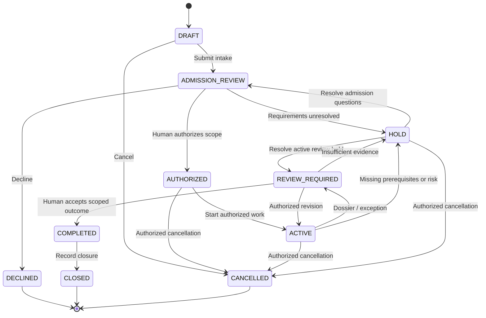
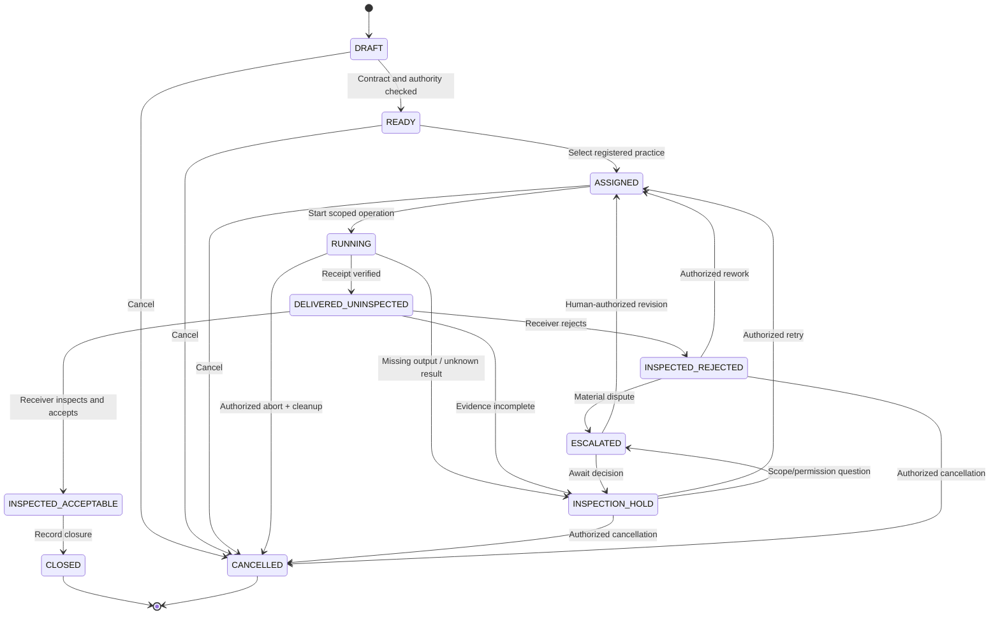

# BOSS V4 — Proposed state machines

**Status:** `CANDIDATE_PENDING_HUMAN_REVIEW`. The diagrams illustrate proposed lifecycle states in architecture §5. They do not implement authorization, release permissions, revocation, concurrency, or idempotent recovery. Every material action needs policy enforcement and an audited decision outside model-generated text.

## Engagement

**Review requirement:** `HOLD` can originate during admission or active work. Resuming must retain the interrupted phase and cannot manufacture authority. `COMPLETED` must bind a human decision to exact scope and artifact identity.

## Work Commission

**PRIME boundary:** `DELIVERED_UNINSPECTED` requires actual receipt; transfer confirmation is not a test pass. `INSPECTED_ACCEPTABLE` describes the *commission receiver's review*, not client approval or public release. Approval requires a distinct authenticated decision record.

These are candidate transitions requiring negative tests and human ratification. They are not a deployed state machine.
