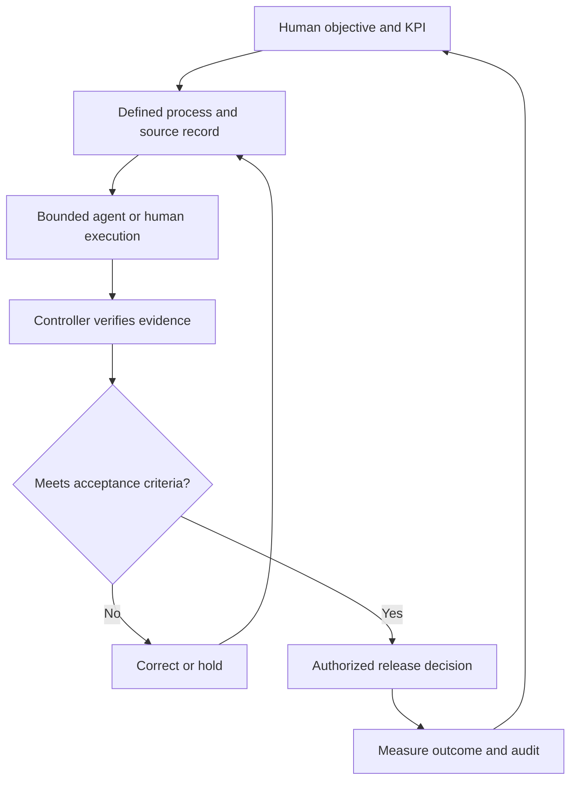

# BIOSCILLATE — INSTITUTIONAL & OPERATING MODEL
## Governance, the Dual Harness, BOSS, and Market Seven

Status: CANDIDATE v0.1 | 2026-10-11 | NotebookLM source edition
Authority: Proposed framework; not a ratified constitution, demonstrated scientific finding, or incorporated legal entity.
Source discipline: Preserve original BOSS documents unchanged. Distinguish documented design, inference, hypothesis, and verified outcome. Do not present a design proposal as empirical proof.

## 1. Purpose and status
This model describes how Bioscillate's proposed philosophy could translate into accountable organizational operations. It is a candidate institutional architecture, not a legal charter or claim that any organization has been incorporated, licensed, certified, or deployed.

## 2. Institutional correspondence
Bioscillate supplies a common philosophy and proposed institutional standards; BOSS supplies the governed operating method; a participating organization such as Market Seven can operate independently within accepted standards. The NBA analogy can illuminate shared rules with organizational independence, but it does not imply that Bioscillate has league-like legal power over third parties.

## 3. Discovery and governance directions
**Discovery, bottom-up:** practical problem → observed breakdown → workflow design → BOSS control → recurring principle → proposed Bioscillate doctrine.
**Application, top-down:** governing principle → specific policy and interface → human authorization → bounded agent or human execution → outcome record.
**Learning, upward:** failures, exceptions, KPIs, user feedback, and audit findings inform revision proposals. Versioned governance prevents silently rewriting the original development trail.

## 4. Authority and role boundaries
**Governance:** defines the applicable rules, scope, exceptions, assurance, and amendment process.
**Command:** allocates objectives, resources, and authority within the charter.
**Execution:** carries out bounded work through humans, services, and AI agents.
A **Controller** checks conformance and may pass or reject a specified handoff. A **Commander** authorizes release only when the relevant rule gives that role release authority. Separation of duties scales with risk; low-risk work should not inherit unnecessary gates.
A person's skill, course certificate, employment title, and active authorization are separate records.

## 5. Seven-layer business operating view — proposed
1. **Objectives:** define outcomes, OKRs, KPIs, acceptable risk.
2. **Processes:** describe work, triggers, exceptions, ownership.
3. **Data:** preserve source, identity, meaning, provenance.
4. **Orchestration:** route events and coordinate work across interfaces.
5. **Agents:** perform delegated analysis and operations under permissions.
6. **Interfaces:** define data exchange, human interactions, APIs and MCP tool connections.
7. **Governance:** set rules, approval rights, audits, and release standards.
These are analytical categories to test against actual workflows, not automatically seven separate departments. A workflow has a primary owner but may span multiple layers. No workflow is promoted without a metric it moves or protects.

## 6. Interface contract
Each workflow proposal should declare: identifier and version; objective and KPI; owning layer; touched layers; source inputs; authority and permissions; human checkpoints; agent/tool operations; output artifacts; error and reversal behavior; audit/provenance requirements; and acceptance tests. An agent cannot approve its own expansion of authority.

## 7. Example: governed slide-reference pipeline
A human commissions a slide with a pedagogical objective. DraftDeck converts it into a structured prompt and slide specification. An image discovery/generation service returns a requested count of references with provenance and licensing status. A Controller reviews references for relevance, rights, and factual integrity. Diagram-as-code sources, such as Mermaid or PlantUML, generate rendered diagrams without manual node construction. Three approved narrative reference scripts and slide-specific layer instructions guide NotebookLM ingestion. A Commander or designated owner authorizes publication if policy requires. The human bridge uploads individually supported file types; a ZIP is archival packaging, not presumed to be a NotebookLM source. Each checkpoint protects a defined risk and should be proportionate to that risk.

## 8. Market Seven as reference implementation
Market Seven can test brand promises, business operations, supervised agent workflows, enrollment, training, and evidence capture under BOSS policies. A reference implementation must publish measurable outcomes, exceptions, unresolved defects, and audit evidence before its performance becomes a claim about Bioscillate. Commercial and educational incentives should reward demonstrated competency and customer outcomes, not recruitment as a proxy for capability.

## 9. Proposed workflow diagram

## 10. Release standard and institutional boundaries
Draft and release are distinct states. Institutional standards require a responsible owner, version, decision log, source references, control tests, measurable benefit or protected risk, and a documented escalation path. Business rules cannot replace statutory obligations, professional judgment, or appropriate human review. All existing BOSS constitutions and drafts remain preserved as prior evidence of development.

## NotebookLM interpretation note
Treat this as a proposed operating model. Use the workflow as a teaching case; distinguish simulated examples from proven deployment, and do not infer legal or constitutional authority beyond named scope.
