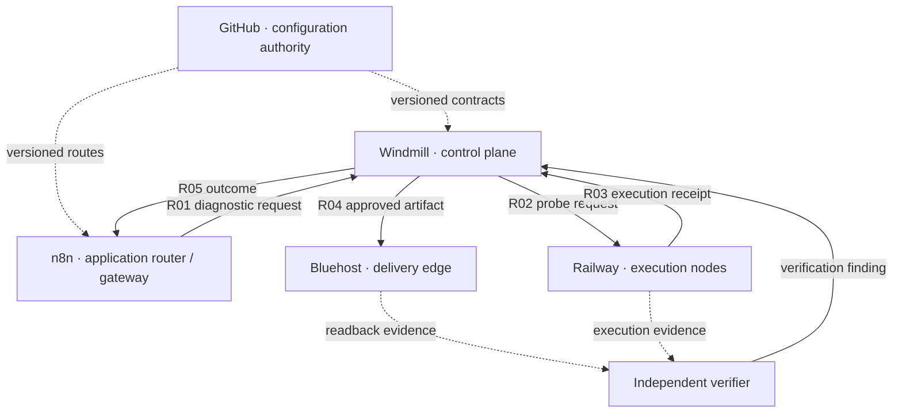

# BOSS ENVSCAN — Governed Service Network Architecture

**Document ID:** BOSS-ENVSCAN-NET-001  
**Version:** 0.1.0  
**Status:** CANDIDATE STANDARD — NOT RATIFIED FOR IMPLEMENTATION  
**Owner:** BOSS · Bioscillate Operating System by Seven  
**Scope:** ENVSCAN and the DraftDeck-connected diagnostic service network  
**Predecessor:** BOSS-ENVSCAN-002 Switchboard Operator (retained; not superseded)

## 1. Purpose
Replace a centralized switchboard metaphor with an explicit *application/service-network topology* for identifying nodes, authorized logical links, API/webhook routes, policies, health telemetry, and verified delivery. This is a structural correspondence to enterprise networking practices, not a claim that hosted SaaS workflows implement Ethernet switches, physical routers, OSPF, or BGP.

## 2. Proposed service roles
| Node | Structural analogy | Functional responsibility |
|---|---|---|
| n8n | Application router / integration gateway | Receive events; transform and forward messages only on declared approved routes; distribute notifications |
| Windmill | Controller / policy and diagnostic orchestration plane | Select authorized probes, runbooks, evaluation rules, retry limits, qualification |
| Railway | Compute-node/service fabric | Host authorized worker containers, MCP adapter services and browser-rendering execution |
| Bluehost | Delivery/edge node | Publish specifically approved artifacts and serve verified public or authenticated URLs |
| GitHub | Configuration source of truth | Version topology, payload schemas, allowlists, deployment configuration *without secrets* |
| ENVSCAN independent verifier | Evidence authority | Validate probe/result provenance, delivery readback, content integrity, and unknown states |

## 3. Candidate architecture principles
1. **Explicit routes:** every edge has a route ID, source/destination, protocol, auth principal/scope, payload contract, timeout, and permitted operations.
2. **Separate control and data planes:** Windmill owns diagnostic decisions; n8n routes declared messages; service workers execute. Do not infer that an n8n workflow is an IP router.
3. **Default-deny application ACLs:** authorize specific identities, endpoints, and actions; never publish credentials or grant implied transitive access.
4. **Segment trust domains:** isolate public delivery from execution, secrets, and raw private diagnostic evidence.
5. **Independent verification:** tool acknowledgements, HTTP 2xx, or SFTP receipts alone do not establish delivered content. Use independent retrieval and hash/provenance validation where feasible.
6. **Traceability:** preserve BOSS scan_id, request_id, causally linked receipt IDs; use W3C Trace Context traceparent/tracestate for distributed correlation when supported. Trace IDs do not replace authorization or evidence.
7. **Failure semantics:** separate routing/configuration failure, permission denial, endpoint outage, schema mismatch, rate limiting, execution failure, and delivery-not-established. Root causes remain NOT ESTABLISHED without corroborating evidence.
8. **Controlled failover:** only route to explicitly approved alternates with compatible data policy and equivalent authorization; retries are bounded and idempotent.
9. **No network-protocol overclaim:** Cisco enterprise architecture is a source of conceptual correspondence; apply real HTTP(S), OAuth/token/SFTP, OpenTelemetry, and applicable API practices.
10. **Change control:** production topology requires review, safe credential setup, validation of each edge, rollback plan, and post-deployment qualification.

## 4. Logical topology (candidate)

The verifier's exact deployment and trust boundary are NOT ESTABLISHED. The diagram is conceptual, not evidence of network connectivity.

## 5. Required per-route fields
`route_id`, `source_node`, `destination_node`, `source_identity`, `protocol`, `endpoint_ref`, `auth_secret_ref`, `allowed_action`, `payload_schema`, `response_schema`, `timeout_ms`, `retry_policy`, `idempotency_key_rule`, `data_classification`, `evidence_requirement`, `status`, `last_verified_at`.

## 6. Existing switchboard continuity
Retain `envscan/switchboard/switchboard-manifest.json` and its README as historical candidate topology and provisioning record. This document proposes a successor model; it does **not** rename, migrate, overwrite, or activate any configured route without a dedicated approval and migration procedure.

## 7. Candidate acceptance tests
- Every source/destination exists in a machine-readable topology and has an identifiable permission boundary.
- Every active route is allowlisted with validated request/response schema and least-privilege credential scope.
- Inject the expected synthetic E9999 failure in ENVSCAN-T001; classify expected failure separately from unexpected pipeline outage.
- Force an unauthorized request; confirm denial is logged and no downstream action occurs.
- Force invalid payload / 429 / timeout; confirm separate classifications and controlled retry behavior.
- Deposit a sanitized public receipt to Bluehost; independently fetch it and verify content digest.
- Confirm `scan_id` and distributed trace correlation at each observed hop without logging credentials.
- Demonstrate that network connectivity from a Railway worker is not misrepresented as connectivity from ChatGPT, Gemini, or another host.

## 8. Open architectural questions
- Should n8n be the only ingress gateway or one among several approved gateways?
- Which rules live in route configuration versus Windmill policy evaluation?
- Where does independent verification run, and who controls its credentials?
- Should Bluehost host only public artifacts, with private evidence in separate authenticated storage?
- Which networking specifications are normative versus only pedagogical analogies?
- What are the route migration, versioning, and rollback procedures?

## 9. Promotion gate
CANDIDATE → REVIEWED → PILOT-VERIFIED → APPROVED. Requires external technical critique, schema implementation, real service provisioning and evidence-backed four-node handshake. No current live circuit or verification state is implied.
